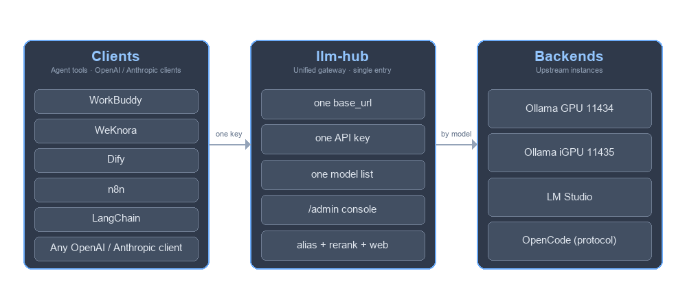
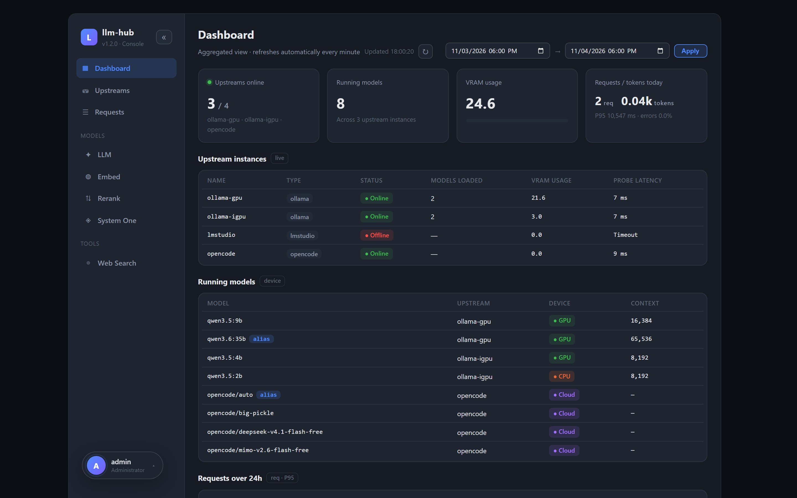
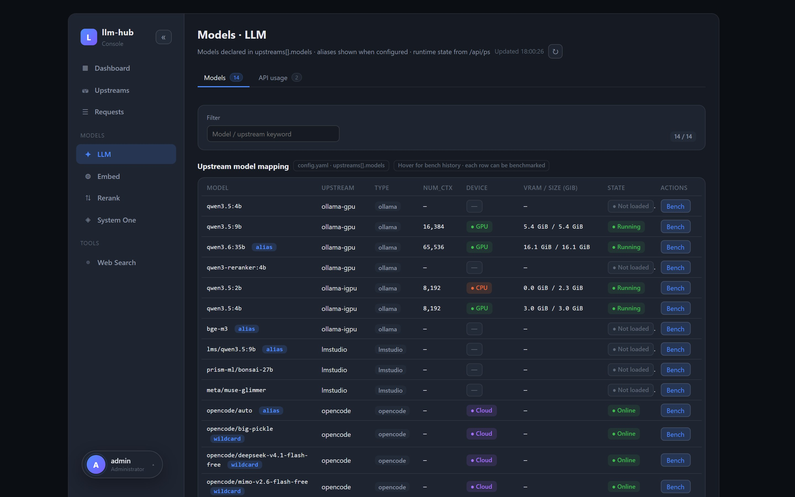

# LLM Hub

**LLM Hub is a self-hosted FastAPI gateway that unifies your local LLM backends behind one
OpenAI-compatible endpoint.**

When you run models locally, the Ollama instances rarely number just one: a desktop discrete GPU, an
integrated GPU, and a pair of nodes on a NAS (internal and public) are common setups. Wiring every
client — WorkBuddy, WeKnora, an SDK, or plain `curl` — to the right host and port by hand gets
tedious fast, and Ollama on its own is missing a few capabilities the rest of the stack expects: a
rerank endpoint for RAG, a web-search pass-through, and an Anthropic-style Messages API.

LLM Hub collapses all of that into a single `base_url`, one API key, and one model list. You send
`model: "qwen3.5:4b-nothink"` and the gateway resolves the alias, selects the upstream that actually
holds the model, injects the pinned parameters, and streams the answer back unchanged. On top of
routing it supplies the endpoints Ollama lacks (rerank, web search, Messages), per-alias parameter
injection (e.g. `think: false`), and a Vue admin console with live request logs, per-model speed
tests, and key management.

[简体中文](README_CN.md) · [Full usage guide](docs/USAGE.md) · [API reference](docs/API.md) ·
[Deployment](docs/DEPLOY.md) · [Changelog](CHANGELOG.md)




## Admin console

Everything the gateway does is visible and operable from the Vue console at `/admin`: upstream
health and VRAM, the model inventory with per-model speed tests (TTFT, decode / prefill tok/s), a
SQLite request log you can filter down to a single call, the rerank keys and configuration
projection, API-key minting and revocation (masked listings only), and a **Test** button on every
documented endpoint. The interface switches between 简体中文 / 繁體中文 / English from the account
menu at the bottom-left.

**Dashboard** — upstream health, VRAM, running models and the request trend.



**Models · LLM** — the model inventory with live device/VRAM and a per-model speed test.



## Deployment

### Local (no Docker)

```bash
# 1. dependencies + config
pip install -r requirements.txt
cp data/config.example.yaml data/config.yaml   # upstreams, aliases, rerank...
cp .env.example .env                           # GATEWAY_API_KEYS, ADMIN_PASSWORD...
# edit both files: real upstream base_urls, real keys

# 2. run (loads ../.env, hot-reloads on save)
cd app
python -m uvicorn main:app --reload --port 8000 --env-file ../.env
```

On Windows, `scripts\start-local.bat` (add `-Install` the first time) runs the same preflight
checks and starts uvicorn for you. Open **<http://localhost:8000/admin/>** and sign in as `admin`
with `ADMIN_PASSWORD`; without that variable the console reports itself disabled and every
management call answers 503. `config.yaml` edits hot-reload in about a second — no restart.

### Docker (recommended)

```bash
# 1. config + secrets (both are mounted, never baked into the image)
mkdir -p llm-hub/data
cp data/config.example.yaml llm-hub/data/config.yaml
cp .env.example llm-hub/.env
# edit both files: real upstream base_urls, real keys

# 2. run
docker run -d --name llm-hub -p 8888:8000 \
  -v $(pwd)/llm-hub/data:/data --env-file llm-hub/.env \
  --restart unless-stopped bruce1977/llm-hub:latest

# 3. verify
curl http://localhost:8888/health          # {"ok":true}
```

Open **<http://localhost:8888/admin/>** and sign in the same way. Building from source:
`docker build -t llm-hub:latest .` — the image is self-contained: the console bundle is committed
in `app/web`, so no Node toolchain is needed.

### Calling it

```bash
KEY=sk-your-gateway-key

# Ollama-native chat (auto-routed; streams NDJSON unless stream=false)
curl http://localhost:8888/api/chat -H "X-API-Key: $KEY" \
  -d '{"model":"qwen3.5:4b","messages":[{"role":"user","content":"hi"}]}'

# OpenAI-compatible
curl http://localhost:8888/v1/chat/completions -H "X-API-Key: $KEY" \
  -H 'Content-Type: application/json' \
  -d '{"model":"qwen3.5:4b","messages":[{"role":"user","content":"hi"}]}'

# Anthropic Messages (the envelope Claude SDK / Claude Code speaks)
curl http://localhost:8888/v1/messages -H "x-api-key: $KEY" \
  -H 'Content-Type: application/json' \
  -d '{"model":"qwen3.5:4b","max_tokens":256,"messages":[{"role":"user","content":"hi"}]}'

# Rerank — something Ollama does not ship
curl http://localhost:8888/v1/rerank -H "X-API-Key: $KEY" \
  -H 'Content-Type: application/json' \
  -d '{"model":"qwen3-reranker:4b","query":"what is a reranker?","documents":["a reranker reorders passages","bananas are yellow"]}'

# Aggregated model list, health
curl http://localhost:8888/v1/models -H "X-API-Key: $KEY"
curl http://localhost:8888/health
```

## Documentation

| Document | What is in it |
|---|---|
| [USAGE.md](docs/USAGE.md) | Full manual: every `config.yaml` section, LM Studio integration, the admin console, calling examples, FAQ, public-deployment security checklist, local development |
| [API.md](docs/API.md) | Every endpoint (Anthropic Messages included) with request/response examples, streaming formats, error codes, alias injection, tool calling |
| [DEPLOY.md](docs/DEPLOY.md) | Deployment: `docker run` and volumes, local Python run, image build/publish scripts, environment variables, troubleshooting, operations |

Requirements: Docker (or Python 3.12 + `pip install -r requirements.txt`).

## Follow & license


Scan the code to follow the project's WeChat official account for release notes, deployment notes
and Q&A.

**License** — released under the [MIT License](LICENSE).

