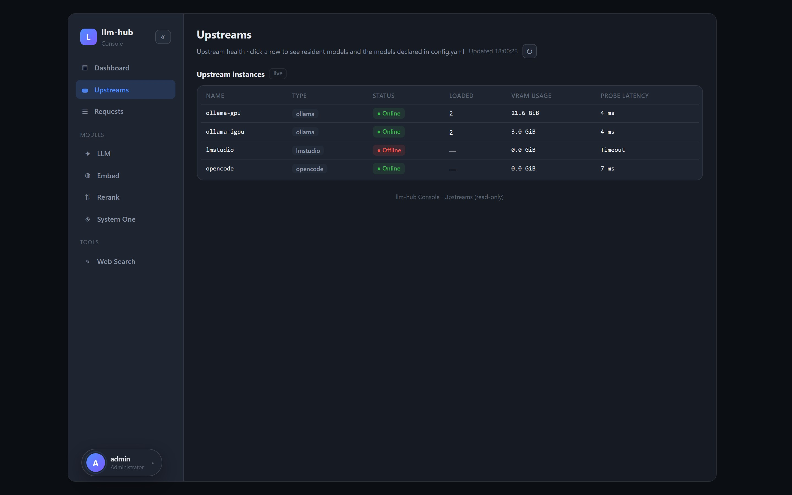
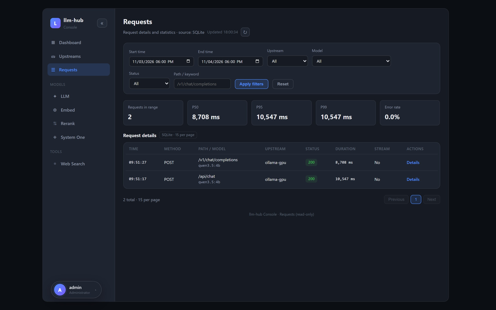
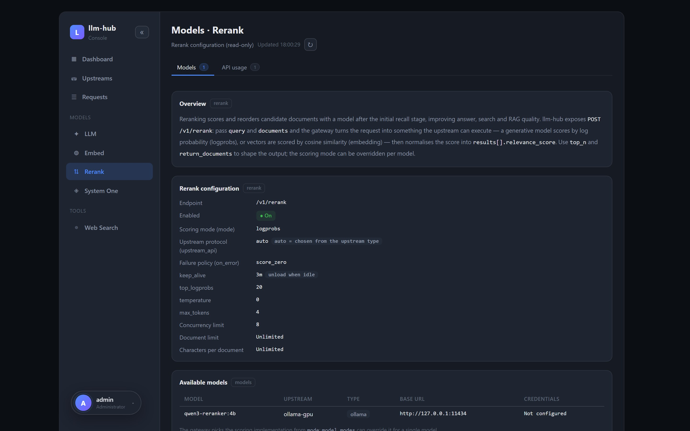
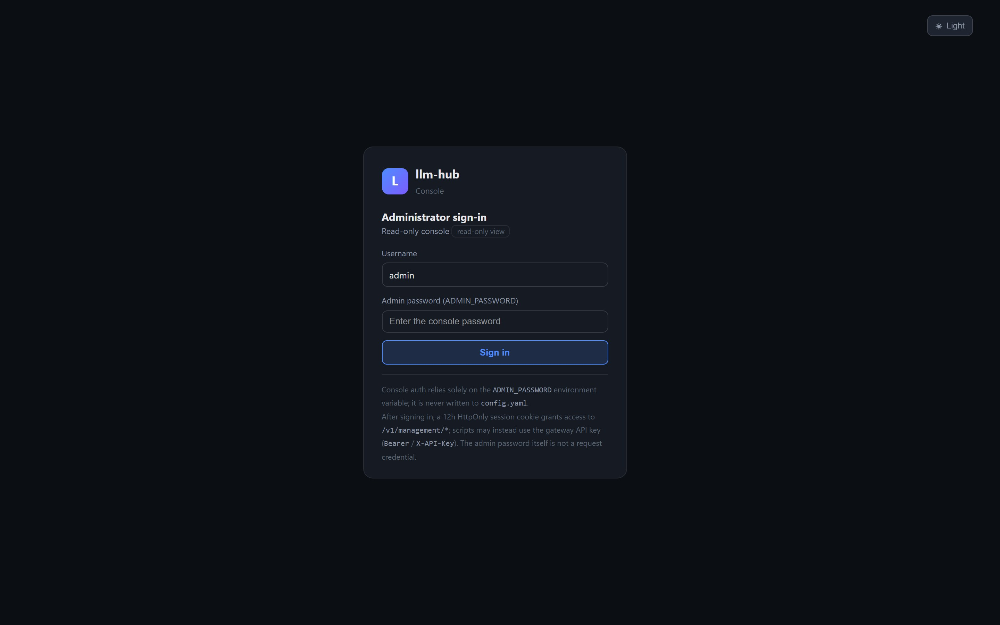

# LLM Hub

**One endpoint in front of every model you run.** LLM Hub sits between your clients — WorkBuddy,
WeKnora, an SDK, plain `curl` — and the backends you already have (several Ollama instances, LM
Studio, an OpenCode gateway). Clients see a single address, one API key and one model list; the
gateway works out which instance actually has the model and forwards the request there. It also
fills the gaps Ollama leaves open: a **Rerank API**, a **web-search proxy**, per-alias parameter
injection (e.g. force `think: false`), and a **web console** with live upstream and request data.

[简体中文](README_CN.md) · [Full usage guide](docs/USAGE.md) · [API reference](docs/API.md) ·
[Deployment](docs/DEPLOY.md) · [Changelog](CHANGELOG.md)


```text
clients                              llm-hub                                 backends
┌────────────────────┐              ┌────────────────────┐              ┌────────────────────┐
│ WorkBuddy          │              │ one base_url       │              │ Ollama GPU 11434   │
│ WeKnora            │── one key ──▶│ one API key        │── model ────▶│ Ollama iGPU 11435  │
│ curl / SDK         │              │ one model list     │              │ LM Studio          │
│                    │              │ /admin console     │              │ OpenCode gateway   │
└────────────────────┘              └────────────────────┘              └────────────────────┘
```

## What you get

| | |
|---|---|
| **Routing by model** | The `model` field decides the upstream — no per-port URLs in your clients. Same model on several instances? Lowest `priority` wins. |
| **One auth layer** | Many keys, constant-time compare, `Bearer` / `X-API-Key`. Keys live in the environment or a secret file, never in `config.yaml`. |
| **APIs Ollama lacks** | `POST /v1/rerank` (logprobs or embedding scoring) and `POST /v1/tools/web-search`, both routed to the upstream that can serve them. |
| **Aliases** | `qwen3.5:4b-nothink` → `qwen3.5:4b` with `think: false` injected; also pins `num_ctx` per model to stop Ollama re-spawning. |
| **Transparent streaming** | NDJSON (`/api/chat`, `/api/generate`) and SSE (`/v1/chat/completions`) are passed through untouched, timings included. |
| **Console + telemetry** | Vue console at `/admin`, request log in SQLite, per-model **speed test** (TTFT, decode / prefill tok/s, last 3 runs), 简体中文 / English. |

## Screenshots

Live renders of the built console against a real gateway — English set in
`docs/screenshots/en/`, Chinese set in `docs/screenshots/zh/` (regenerate them with
`node docs/web-management/capture-live.js`). The console language switches from the account menu
at the bottom-left.

| Dashboard — health, VRAM, running models, traffic | Upstreams — probe latency and declared models |
|:--:|:--:|
| [](docs/screenshots/en/dashboard.jpg) | [](docs/screenshots/en/upstreams.jpg) |
| **Models · LLM** — inventory, live device/VRAM, speed test | **Requests** — SQLite log, filters, per-request detail |
| [](docs/screenshots/en/models-llm.jpg) | [](docs/screenshots/en/requests.jpg) |
| **Models · Rerank** — config projection, keys masked | **Login gate** — password → 12h HttpOnly cookie |
| [](docs/screenshots/en/models-rerank.jpg) | [](docs/screenshots/en/login.jpg) |

## Quick start

```bash
# 1. config + secrets (both are mounted, never baked into the image)
mkdir -p llm-hub/data
cp data/config.example.yaml llm-hub/data/config.yaml   # upstreams, aliases, rerank...
cp .env.example llm-hub/.env                           # GATEWAY_API_KEYS, ADMIN_PASSWORD...
# edit both files: real upstream base_urls, real keys

# 2. run
docker run -d --name llm-hub -p 8888:8000 \
  -v $(pwd)/llm-hub/data:/data --env-file llm-hub/.env \
  --restart unless-stopped bruce1977/llm-hub:latest

# 3. verify
curl http://localhost:8888/health          # {"ok":true}
```

Then open **<http://localhost:8888/admin/>** and sign in as `admin` with `ADMIN_PASSWORD`. Without
that variable the console reports itself as disabled and every management call answers 503.
`config.yaml` edits hot-reload in about a second — no restart.

Building from source instead: `docker build -t llm-hub:latest .` — see
[USAGE.md](docs/USAGE.md#quick-start), which also covers a bare-metal run without Docker.

## Talk to it

```bash
KEY=sk-your-gateway-key

# Ollama-native chat (auto-routed; streams NDJSON unless stream=false)
curl http://localhost:8888/api/chat -H "X-API-Key: $KEY" \
  -d '{"model":"qwen3.5:4b","messages":[{"role":"user","content":"hi"}]}'

# OpenAI-compatible
curl http://localhost:8888/v1/chat/completions -H "X-API-Key: $KEY" \
  -H 'Content-Type: application/json' \
  -d '{"model":"qwen3.5:4b","messages":[{"role":"user","content":"hi"}]}'

# Rerank — something Ollama does not ship
curl http://localhost:8888/v1/rerank -H "X-API-Key: $KEY" \
  -H 'Content-Type: application/json' \
  -d '{"model":"qwen3-reranker:4b","query":"what is a reranker?","documents":["a reranker reorders passages","bananas are yellow"]}'

# Aggregated model list, health
curl http://localhost:8888/v1/models -H "X-API-Key: $KEY"
curl http://localhost:8888/health
```

## Documentation

| Document | What is in it |
|---|---|
| [USAGE.md](docs/USAGE.md) | Everything: config reference (`server` / `auth` / `upstreams` / `routing` / `aliases` / `rerank` / `websearch` / `request_log`), LM Studio integration, web console internals, full endpoint docs, FAQ, security checklist, local development |
| [docs/API.md](docs/API.md) | Forwarding rules, error codes, request/response examples |
| [docs/DEPLOY.md](docs/DEPLOY.md) | Image build and publish scripts, reverse proxy, volumes |
| [docs/TESTCASES.md](docs/TESTCASES.md) | End-to-end test matrix (smoke / management / gateway) |
| [docs/web-management/](docs/web-management/web-management-implementation.md) | How the console is built, screens, capture scripts |
| [CHANGELOG.md](CHANGELOG.md) | Release notes |

Requirements: Docker (or Python 3.12 + `pip install -r requirements.txt`). The console bundle is
committed in `app/web`, so the image needs no Node toolchain.
