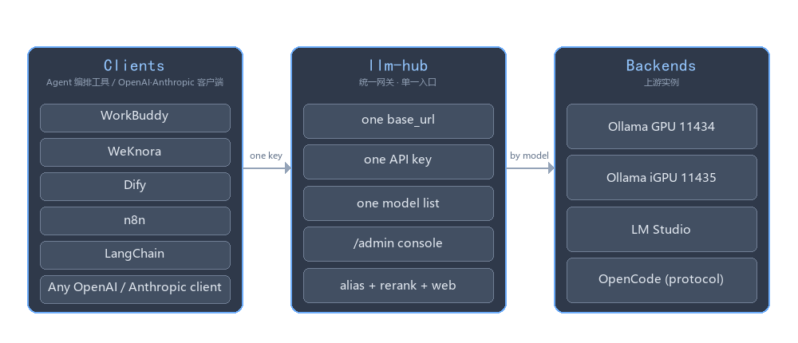
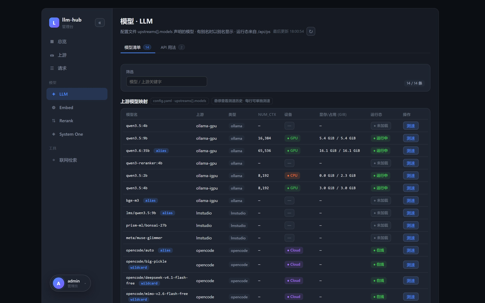

# LLM Hub

**LLM Hub 是一个自托管的 FastAPI 网关，把分散在多台机器、多张显卡上的本地大模型后端，收敛成一个 OpenAI 兼容的统一入口。**

本地跑大模型时，Ollama 实例往往不止一个：桌面独显一套、核显一套，NAS 上内网和公网
再各挂一套，是再正常不过的部署。让每个客户端（WorkBuddy、WeKnora、SDK 或 `curl`）
逐个去记端口、逐个去配密钥，维护起来很累；而 Ollama 原生又缺几样上层应用要用的能力
——给 RAG 用的 rerank、联网检索，以及 Anthropic 风格的 Messages 接口。

LLM Hub 把这些收敛成一个 `base_url`、一把密钥、一份模型清单：你只管在请求里写
`model: "qwen3.5:4b-nothink"`，网关负责解析别名、挑出真正持有该模型的上游、注入固化
参数，再把回答原样流式返回。除了路由，它还补齐了 Ollama 缺的三类接口（rerank、web
search、Messages），支持按别名强制注入参数（如 `think: false`），并附带一个 Vue 管理台，
提供实时请求明细、每模型测速与密钥管理。

[English](README.md) · [完整使用手册](docs/USAGE_CN.md) · [接口文档](docs/API_CN.md) ·
[部署说明](docs/DEPLOY_CN.md) · [配置节点说明](docs/CONFIG_CN.md) · [更新日志](CHANGELOG.md)




## 管理网站

网关的所有能力都能在 `/admin` 的 Vue 控制台里查看和操作：上游健康与显存、模型清单（含每模型
测速：TTFT、decode / prefill 速度、最近三次）、可按条件筛选到单条请求的 SQLite 明细、Rerank
的密钥与配置投影、API Key 的签发与吊销（列表只显示掩码），以及每个文档化接口参数表右上角的
**测试**按钮。界面支持简体中文 / 繁體中文 / English，在左下角账户菜单切换。

**总览** —— 上下游健康、显存占用、运行中的模型与请求趋势。


**模型 · LLM** —— 模型清单、运行态设备与显存、单模型测速。



## 如何部署

### 本地部署（不经 Docker）

```bash
# 1. 安装依赖与准备配置
pip install -r requirements.txt
cp data/config.example.yaml data/config.yaml   # 上游、别名、rerank……
cp .env.example .env                           # ADMIN_PASSWORD（登录管理台）、可选后端密钥
# 编辑这两个文件：填真实上游地址和真实密钥

# 2. 启动（自动加载 ../.env，保存即热重载）
cd app
python -m uvicorn main:app --reload --port 8000 --env-file ../.env --no-proxy-headers
```

Windows 可直接用 `scripts\start-local.bat`（首次加 `-Install`），它做同样的启动前检查并拉起
网关：默认单监听用 uvicorn + 自动重载，加 `-PublicPorts 8001` 或 `-NoReload` 则走加固入口
`serve.py`（多监听、无自动重载）。打开 **<http://localhost:8000/admin/>**，用 `admin` +
`ADMIN_PASSWORD` 登录；不设这个变量时管理台显示「未启用」，所有管理接口返回 503。
**调用方 Key 只在管理台签发**：登录后进「API Key 管理 → 新建」——没有任何环境变量或密钥文件
能注入 Key，空表就是正常的首次启动状态（需要 Key 的请求一律 401），明文只显示一次。
改 `config.yaml` 约 1 秒热重载，不用重启。管理台默认只在内网口提供；要在公网口访问，把
`security.public.admin_endpoints` 设为 `allow`（管理面仍只认会话 Cookie——网关 Key 不是管理凭据）。
手动启动 uvicorn 时务必带 `--no-proxy-headers`，
否则调用方提交的 `X-Forwarded-For` 能改写用于白名单判断的客户端 IP。

### Docker 部署（推荐）

```bash
# 1. 配置与密钥（都是挂载进去的，不打进镜像）
mkdir -p llm-hub/data
cp data/config.example.yaml llm-hub/data/config.yaml
cp .env.example llm-hub/.env
# 编辑这两个文件：填真实上游地址和真实密钥

# 2. 启动
docker run -d --name llm-hub -p 8888:8000 \
  -v $(pwd)/llm-hub/data:/data --env-file llm-hub/.env \
  --restart unless-stopped bruce1977/llm-hub:latest

# 3. 验证
curl http://localhost:8888/health          # {"ok":true}
```

打开 **<http://localhost:8888/admin/>**，同样用 `admin` + `ADMIN_PASSWORD` 登录。想从源码构建镜像：
`docker build -t llm-hub:latest .`；镜像自带管理台产物（`app/web` 已提交），构建不需要 Node。

### 调用方式

```bash
KEY=sk-hub-……   # 在 /admin → API Key 管理 签发，明文只显示一次

# Ollama 原生聊天（自动路由；不写 stream 即流式 NDJSON）
curl http://localhost:8888/api/chat -H "X-API-Key: $KEY" \
  -d '{"model":"qwen3.5:4b","messages":[{"role":"user","content":"hi"}]}'

# OpenAI 兼容
curl http://localhost:8888/v1/chat/completions -H "X-API-Key: $KEY" \
  -H 'Content-Type: application/json' \
  -d '{"model":"qwen3.5:4b","messages":[{"role":"user","content":"hi"}]}'

# Anthropic Messages（Claude SDK / Claude Code 用的信封）
curl http://localhost:8888/v1/messages -H "x-api-key: $KEY" \
  -H 'Content-Type: application/json' \
  -d '{"model":"qwen3.5:4b","max_tokens":256,"messages":[{"role":"user","content":"hi"}]}'

# Rerank —— Ollama 本身没有这个接口
curl http://localhost:8888/v1/rerank -H "X-API-Key: $KEY" \
  -H 'Content-Type: application/json' \
  -d '{"model":"qwen3-reranker:4b","query":"什么是 reranker？","documents":["reranker 会给段落重新排序","香蕉是黄色的"]}'

# 聚合模型列表与健康检查
curl http://localhost:8888/v1/models -H "X-API-Key: $KEY"
curl http://localhost:8888/health
```

## 文档

| 文档 | 内容 |
|---|---|
| [USAGE_CN.md](docs/USAGE_CN.md) | 完整手册：`config.yaml` 各段配置详解、集成 LM Studio、管理台使用、调用示例、常见问题、公网安全清单、本地开发 |
| [API_CN.md](docs/API_CN.md) | 全部端点（含 Anthropic Messages）的请求 / 响应示例、流式格式、错误码、别名参数注入、工具调用 |
| [DEPLOY_CN.md](docs/DEPLOY_CN.md) | 部署：Docker 运行与目录挂载、本地 Python 运行、镜像构建 / 发布脚本、环境变量、常见问题与运维 |
| [CONFIG_CN.md](docs/CONFIG_CN.md) | 逐个节点说明 `config.yaml`：文件如何读取与热重载、每个键的默认值与读取方、公网路径范围、已移除的节点，以及如何确认某个键真的生效 |

环境要求：Docker（或 Python 3.12 + `pip install -r requirements.txt`）。

## 关注公众号与授权


扫码关注公众号，获取版本更新、部署说明与答疑。

**使用授权** —— 本项目以 [MIT License](LICENSE) 开源。

