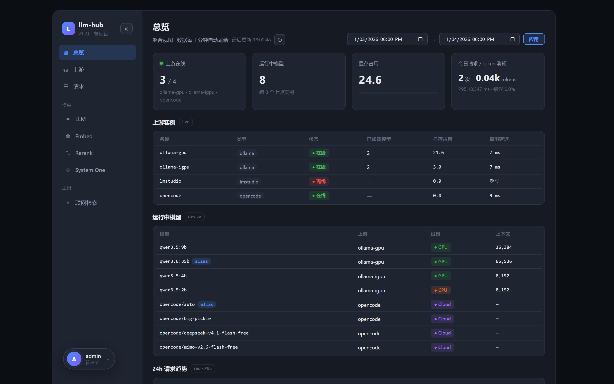
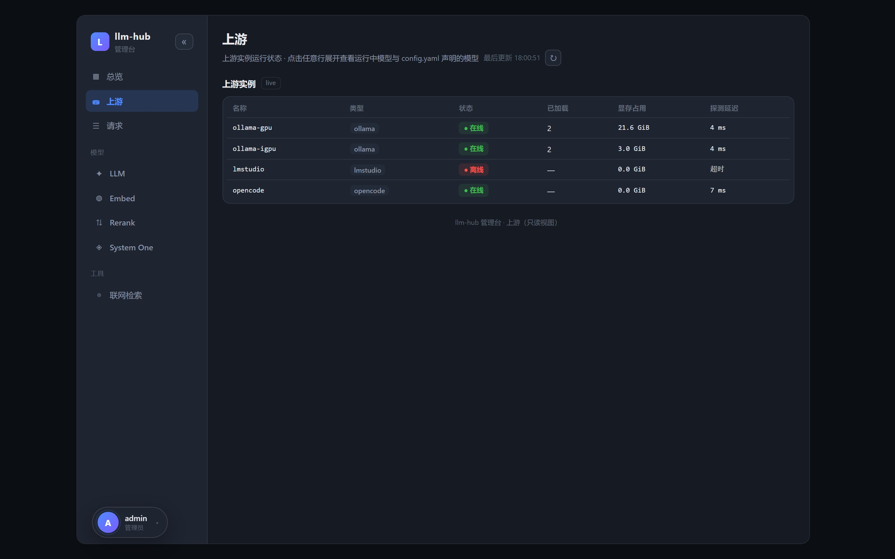
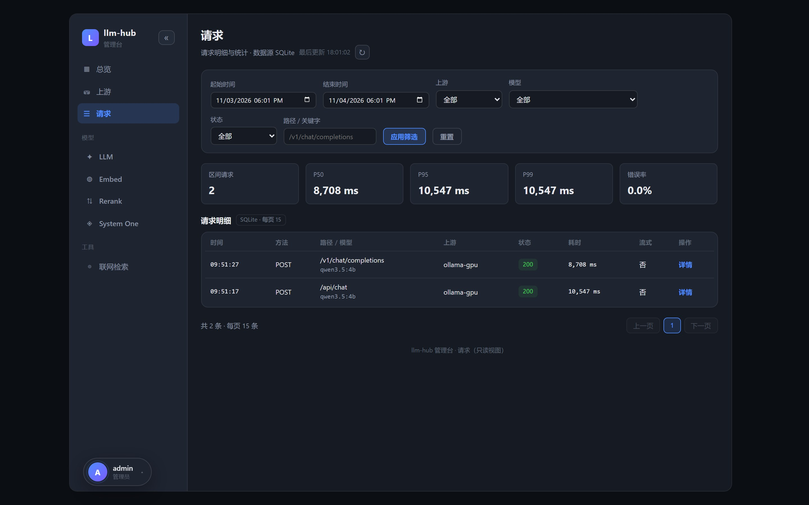
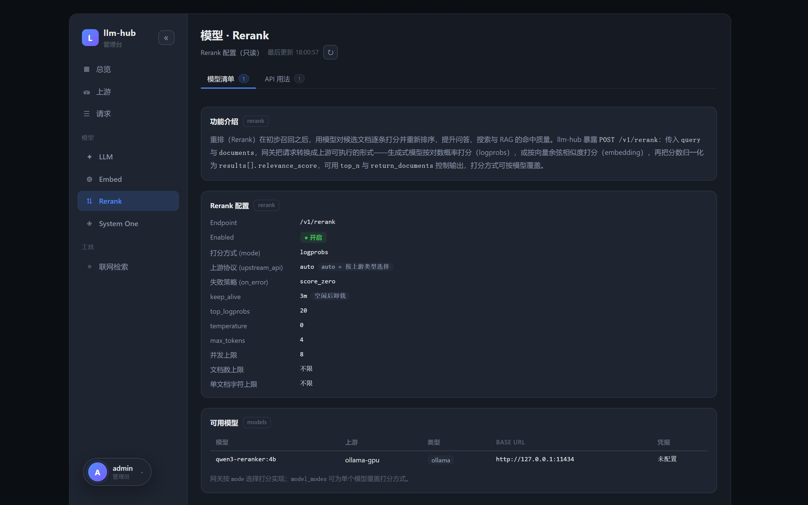
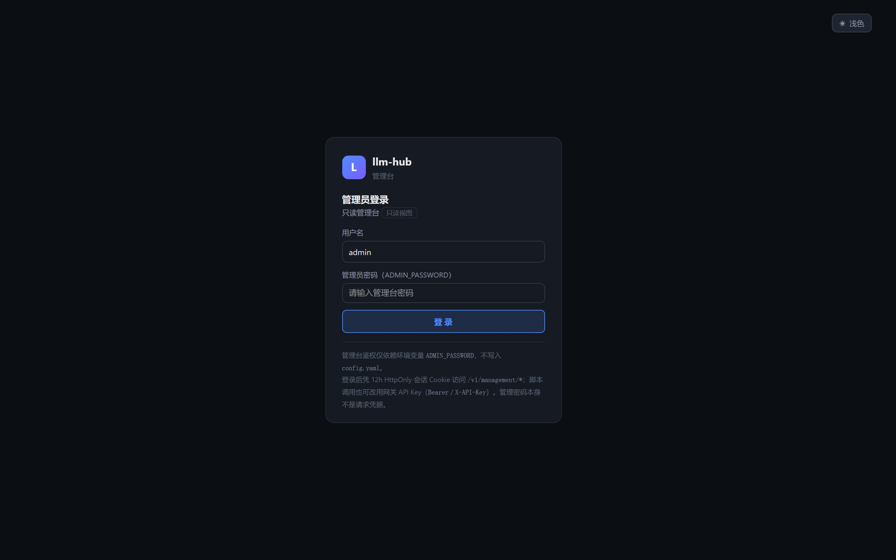

# LLM Hub

**在你所有模型前面放一个统一入口。** LLM Hub 夹在客户端（WorkBuddy、WeKnora、SDK、`curl`）和
你已有的后端（多个 Ollama 实例、LM Studio、OpenCode 网关）之间：客户端只看到一个地址、一把
API Key、一份模型列表，网关自己判断哪个实例真的有这个模型并转发过去。同时补齐 Ollama 缺的
能力：**Rerank API**、**联网检索代理**、按别名强制注入参数（如 `think: false`），以及一个能看到
上游状态和请求明细的**Web 管理台**。

[English](README.md) · [完整使用手册](docs/USAGE_CN.md) · [接口文档](docs/API.md) ·
[部署说明](docs/DEPLOY.md) · [更新日志](CHANGELOG_CN.md)


```text
clients                              llm-hub                                 backends
┌────────────────────┐              ┌────────────────────┐              ┌────────────────────┐
│ WorkBuddy          │              │ one base_url       │              │ Ollama GPU 11434   │
│ WeKnora            │── one key ──▶│ one API key        │── model ────▶│ Ollama iGPU 11435  │
│ curl / SDK         │              │ one model list     │              │ LM Studio          │
│                    │              │ /admin console     │              │ OpenCode gateway   │
└────────────────────┘              └────────────────────┘              └────────────────────┘
```

## 它解决什么

| | |
|---|---|
| **按模型路由** | 请求体里的 `model` 决定去哪个上游，客户端不用记端口。同一模型多处部署时按 `priority` 最小者优先。 |
| **一层统一鉴权** | 多 Key 并存、常量时间比较、兼容 `Bearer` / `X-API-Key`。Key 只来自环境变量或密钥文件，不落 `config.yaml`。 |
| **补齐 Ollama 缺的接口** | `POST /v1/rerank`（logprobs 或向量打分）与 `POST /v1/tools/web-search`，都路由到能提供服务的那个上游。 |
| **别名与参数注入** | `qwen3.5:4b-nothink` → 转发 `qwen3.5:4b` 并注入 `think: false`；还可按模型固定 `num_ctx`，避免 Ollama 反复重建。 |
| **流式原样透传** | NDJSON（`/api/chat`、`/api/generate`）与 SSE（`/v1/chat/completions`）不改写，计时字段一并保留。 |
| **管理台 + 观测** | `/admin` 上的 Vue 控制台、SQLite 请求明细、每模型**测速**（TTFT、decode / prefill 速度、保留最近 3 次），界面支持中文 / English。 |

## 界面截图

以下都是构建产物（`app/web`）连真实网关跑出来的实拍，不是设计稿：英文版在
`docs/screenshots/en/`，中文版在 `docs/screenshots/zh/`（用
`node docs/web-management/capture-live.js` 可重新生成）。语言在左下角账户菜单里切换。

| 总览 —— 上下游健康、显存、运行中模型、请求趋势 | 上游 —— 探测延迟与声明的模型 |
|:--:|:--:|
| [](docs/screenshots/zh/dashboard.jpg) | [](docs/screenshots/zh/upstreams.jpg) |
| **模型 · LLM** —— 清单、运行态设备/显存、测速 | **请求** —— SQLite 明细、筛选、单条详情 |
| [](docs/screenshots/zh/models-llm.jpg) | [](docs/screenshots/zh/requests.jpg) |
| **模型 · Rerank** —— 配置投影，密钥打码 | **登录门禁** —— 密码换 12 小时 HttpOnly Cookie |
| [](docs/screenshots/zh/models-rerank.jpg) | [](docs/screenshots/zh/login.jpg) |

## 快速开始

```bash
# 1. 配置与密钥（都是挂载进去的，不打进镜像）
mkdir -p llm-hub/data
cp data/config.example.yaml llm-hub/data/config.yaml   # 上游、别名、rerank……
cp .env.example llm-hub/.env                           # GATEWAY_API_KEYS、ADMIN_PASSWORD……
# 编辑这两个文件：填真实上游地址和真实密钥

# 2. 启动
docker run -d --name llm-hub -p 8888:8000 \
  -v $(pwd)/llm-hub/data:/data --env-file llm-hub/.env \
  --restart unless-stopped bruce1977/llm-hub:latest

# 3. 验证
curl http://localhost:8888/health          # {"ok":true}
```

然后打开 **<http://localhost:8888/admin/>**，用 `admin` + 环境变量 `ADMIN_PASSWORD` 登录；
不设这个变量时管理台显示「未启用」，所有管理接口返回 503。改 `config.yaml` 约 1 秒热重载，
不用重启。

想从源码构建镜像：`docker build -t llm-hub:latest .`；不想用 Docker 也可以裸跑，
两种方式都写在[使用手册](docs/USAGE_CN.md#快速开始)里。

## 怎么调用

```bash
KEY=sk-your-gateway-key

# Ollama 原生聊天（自动路由；不写 stream 即流式 NDJSON）
curl http://localhost:8888/api/chat -H "X-API-Key: $KEY" \
  -d '{"model":"qwen3.5:4b","messages":[{"role":"user","content":"hi"}]}'

# OpenAI 兼容
curl http://localhost:8888/v1/chat/completions -H "X-API-Key: $KEY" \
  -H 'Content-Type: application/json' \
  -d '{"model":"qwen3.5:4b","messages":[{"role":"user","content":"hi"}]}'

# Rerank —— Ollama 本身没有这个接口
curl http://localhost:8888/v1/rerank -H "X-API-Key: $KEY" \
  -H 'Content-Type: application/json' \
  -d '{"model":"qwen3-reranker:4b","query":"什么是 reranker？","documents":["reranker 会给段落重新排序","香蕉是黄色的"]}'

# 聚合模型列表与健康检查
curl http://localhost:8888/v1/models -H "X-API-Key: $KEY"
curl http://localhost:8888/health
```

## 文档

| 文档 | 内容 |
|---|---|
| [USAGE_CN.md](docs/USAGE_CN.md) | 全部细节：配置详解（`server` / `auth` / `upstreams` / `routing` / `aliases` / `rerank` / `websearch` / `request_log`）、集成 LM Studio、管理台实现、完整接口说明、常见问题、公网安全清单、本地开发 |
| [docs/API.md](docs/API.md) | 转发规则、错误码、请求/响应示例 |
| [docs/DEPLOY.md](docs/DEPLOY.md) | 镜像构建与发布脚本、反向代理、挂载 |
| [docs/TESTCASES.md](docs/TESTCASES.md) | 端到端测试矩阵（smoke / management / gateway） |
| [docs/web-management/](docs/web-management/web-management-implementation.md) | 管理台如何实现、各页面说明、截图脚本 |
| [CHANGELOG_CN.md](CHANGELOG_CN.md) | 版本变更记录 |

环境要求：Docker（或 Python 3.12 + `pip install -r requirements.txt`）。管理台产物已提交在
`app/web`，镜像里不需要 Node 工具链。
