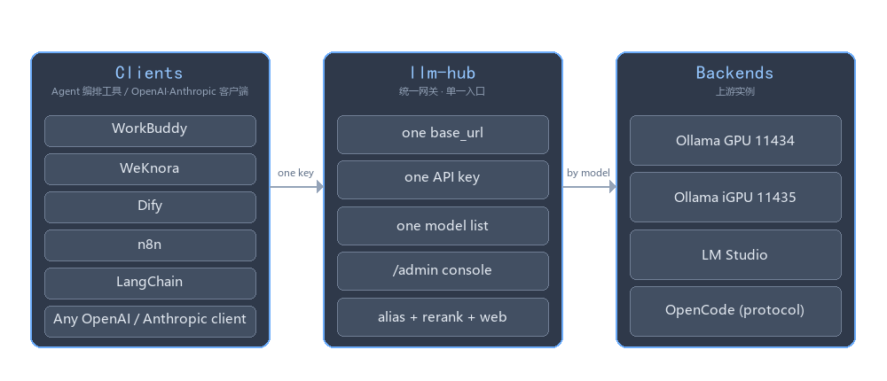
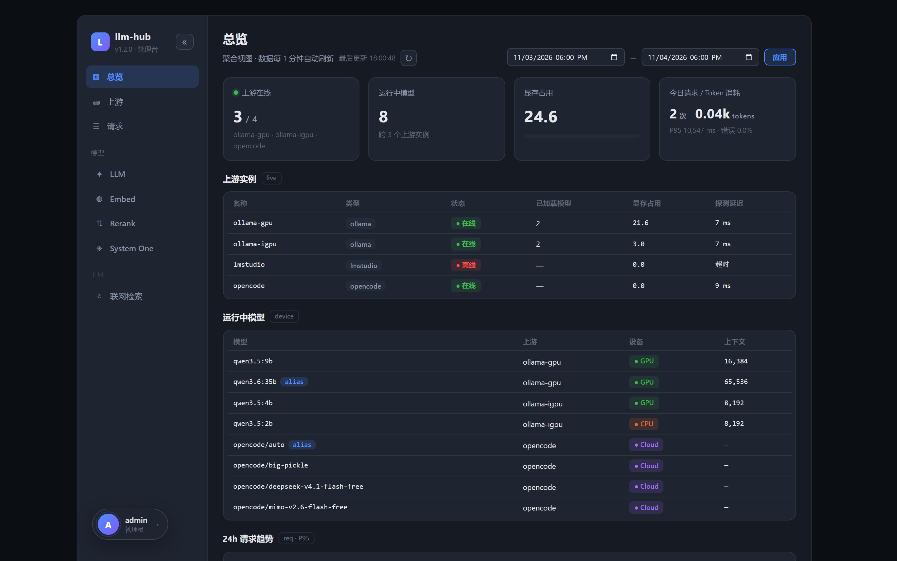
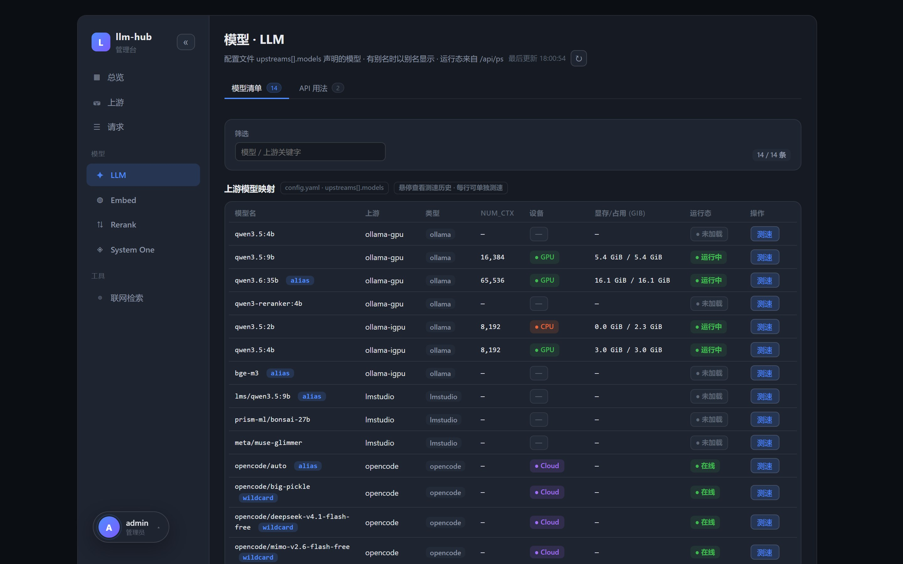

# 家里四套 Ollama、三个客户端之后，我给本地模型加了一层网关

> 不是又一个聊天套壳。它做的事很朴素：把散在多台机器、多张卡上的本地推理实例，收敛成一个 `base_url`、一把密钥、一份模型清单；顺手补上 Ollama 没有的 rerank、联网检索和 Anthropic Messages 协议，以及一个能查「刚才那次到底走的哪个上游」的管理台。项目叫 **LLM Hub**，MIT 开源，本文所有配置和命令都来自它的中文文档。



*（图 1：网关在中间，上游是若干 Ollama / LM Studio / 托管实例，客户端只认一个入口）*

---

## 一、先说那个让人烦躁的晚上

本地跑模型，最初都是一台机器一个 `ollama serve`，`localhost:11434` 打开就能用，`ollama run` 敲完就出字，很美好。

问题不是一天出现的，是慢慢长出来的。先是主力模型搬到了独显那台（11434），后来为了留住一个老版本的 IPEX-LLM 兼容构建，又在核显上起了第二套（11435）；再后来 NAS 上为了内网和公网各挂一套网关，公网那套还得多配一层 token。客户端这边也没闲着：WorkBuddy 一个地址、WeKnora 的 RAG 链路一个地址、临时写的脚本一个地址，Claude 系的客户端还想用 Anthropic 协议接本地模型。

于是维护清单慢慢长成了这样：

| 要维护的东西 | 麻烦在哪 |
|---|---|
| 四套上游的地址与端口 | 每套还各有一份「这台装了哪些模型」的清单 |
| 三四个客户端各一份 `base_url` | 改一次上游要挨个改，还经常改漏 |
| 每个客户端一把 key | 轮换一次要全改一遍，谁改了、谁没改，没有记录 |
| 每台机器上的显存现状 | 只能 SSH 上去敲 `ollama ps`，和客户端配置对不上 |

最烦的不是记不住，是**没人知道哪一份是准的**。上周改过 NAS 那台的端口，这周在另一台机器上跑脚本用的还是旧地址，报错还长得像「模型不存在」，查了半小时才想起来是地址过期。

我试过三种临时办法：给每台上游套一层 nginx 统一路径，结果地址还是四个，只是从端口变成了域名；把「当前可用地址」写进共享笔记，三天就过期，而且没有任何一处会校验它；在应用侧写个路由函数，每加一个客户端就复制一份，参数注入的逻辑开始分叉。三种都只是把混乱挪了个地方。

真正让我下决心写个独立进程的，是下面几个更具体的瞬间：

1. **协议不统一。** Ollama 原生是 `/api/chat`、`/api/generate`，不写 `stream` 默认就是流式 NDJSON；OpenAI 兼容客户端只认 `/v1/chat/completions`；Claude 系工具发的是 `/v1/messages` 那套信封（`content` 块、`stop_reason`、`usage`）。让每个上游去适配一遍不现实，让每个客户端去改更不现实。
2. **Ollama 没有 rerank。** WeKnora 这类 RAG 在召回之后要重排，网关之外只有两条路：在应用侧糊一个打分服务，或者把 `qwen3-reranker` 当聊天模型硬凑。而 embedding 和 rerank 用的本来就是同一批本地模型（`bge-m3`、`qwen3-reranker:4b`），却要让两个客户端各配一遍地址，更没道理。
3. **出事查不动。** 某个回答突然变慢，客户端只显示「慢」。它打到了独显还是核显？是不是刚触发了模型重载？输入输出各多少 token、首字等了多久？Ollama 自己不会告诉你，日志里也没有跨请求的线索。
4. **显存被悄悄吃光。** 不同客户端各传各的 `num_ctx`，Ollama 会为「模型 + `options.num_ctx`」的**每种组合创建独立实例**并一次性预分配 KV cache。同一个模型在机器上出现好几份，显存一层层叠上去，一开始还以为是模型变胖了。
5. **想从外面用，又不敢把 11434 直接映射出去。** 那个端口上挂着 `/api/pull`、`/api/create`、`/api/delete`、`/api/push`，Ollama 默认没有鉴权；就算前面套了反代，`X-Forwarded-For` 也是可以伪造的，白名单不能照抄请求头。裸奔等于把机器的模型目录交给公网。

这几件事没有一件是「模型不够强」，全是工程问题。所以我没去换模型，写了个薄薄的网关：它不生产 token，只负责把请求送到对的实例、把参数整理好、把过程记下来。

---

## 二、为什么没直接用现成的聚合工具

云 API 聚合、多供应商路由这类项目做得很成熟，我最早也试过。后来发现不是「够不够好」的问题，是**要解决的问题根本不在同一层**：

| 维度 | 云 API 聚合 | 我这边 |
|---|---|---|
| 聚合对象 | 十几家厂商的云端 endpoint | 同一局域网里几个自己跑的推理实例 |
| 关心的指标 | 计费、配额、供应商可用性 | 这个模型在哪张卡上、显存还剩多少、有没有被重载 |
| 请求改写 | 统一成一种协议 | 按模型名注入固化参数、钳死 `num_ctx`、同名模型按 `priority` 挑上游 |
| 凭据模型 | 各家厂商的 key | 一把网关 key 打所有本地实例，密钥不落配置文件 |
| 可观测 | 账单与调用量 | 逐条请求明细 + 每模型 TTFT / decode / prefill |
| 部署形态 | 常驻服务 + 外部数据库 | 一个进程、一份 YAML、一个 SQLite 文件；容器里不装 Node |

有三条需求，通用聚合层通常不会当成一等公民：

- **按模型名注入参数**：同一个底座模型，某个调用场景要强制关思考、另一个要保留，最好在配置里写成两个名字，而不是让每个客户端记得传 `think: false`。
- **把 `num_ctx` 钳死**：理由就是上一节那个显存坑。这属于「网关替调用方收拾参数」，不是路由本身。
- **自带观测**：为一台机器再部署一套 Prometheus + Grafana，比问题本身重得多；我只想要一张能翻到单条请求的明细表和一次点击就能跑的测速。

于是给它定了三条原则，后面所有实现细节基本都从这三条推出来：

1. **只做转发，不改协议语义。** Ollama 的 NDJSON 和 OpenAI 的 SSE 原样流过去，网关不重新组装回答内容。唯一主动改写协议的是 `/v1/messages` —— 客户端发的本来就是 Anthropic 信封，这一步躲不掉，详见第四节。
2. **配置是唯一真源。** 一个带注释的 `config.yaml`，改完约 1 秒热重载，不用重启容器；调用方密钥由管理台签发、存在本地 SQLite 里（启动后用 `ADMIN_PASSWORD` 登录 `/admin` 签第一把，没有任何环境变量能注入），配置文件里放不下任何凭据。管理台绝大多数页面只是这份配置的只读投影，唯一会写它的是 Settings 页。
3. **调用面和管理面分开。** 调用方用 API Key（`Bearer` / `X-API-Key`），管理台用 12 小时 HttpOnly 会话 Cookie；签发、吊销 Key 的三个接口只认会话 Cookie —— 网关 Key 是每个客户端都持有的东西，不能拿它给自己再发一把。

技术选型也就没什么悬念：FastAPI 处理异步与流式透传；请求明细进 SQLite（WAL，不引入额外数据库）；管理台用 Vue 3 + TypeScript 写，但**构建产物直接提交进仓库**，镜像 `COPY` 进去就能用。整个服务是单进程、单个配置文件、一个数据库文件，Docker 一条命令拉起。

所以它的定位更接近「本地推理机的机柜管理器」，而不是 API 中转站。顺带把边界说清楚：它不下载模型、不做量化、不做跨实例调度，也不复用 KV cache —— 这些是推理引擎的事，网关不该插手。

---

## 三、一个地址、一把钥匙、一份模型清单

配置是唯一真源，就是一个带注释的 `data/config.yaml`：

```yaml
upstreams:
  - name: local-main
    type: ollama
    base_url: http://host.docker.internal:11434
    models: [qwen3.5:9b, qwen3.5:4b, qwen3.6:35b-pruned]
    priority: 0
    vram_total_gb: 32.0        # 只喂给管理台的显存进度条，API 探测不到

  - name: local-igpu
    type: ollama
    base_url: http://host.docker.internal:11435
    models: [qwen3.5:4b]        # 同名模型：priority 大的做兜底
    priority: 10

  - name: lmstudio
    type: lmstudio
    base_url: http://host.docker.internal:1234
    models: []
    model_aliases: {qwen/qwen3.5-9b: qwen3.5:9b}

aliases:
  qwen3.5:4b-nothink:          # 这是一个独立模型，不是改名
    model: qwen3.5:4b
    params:
      think: false

num_ctx_overrides:
  qwen3.6:35b-pruned: 65536
  qwen3.5:9b: 16384
```

几个值得单独说的点：

- `models` 支持**字面前缀通配**，`qwen3:*` 能命中 `qwen3:4b`、`qwen3:8b`；带斜杠的 id 要写 `opencode/*`，写成 `opencode:*` 一个都匹配不到（这个坑我在文档里标了）。
- 同名模型落在多个上游时，按 `priority` **数值最小**者优先，并列时按声明顺序。上面那份配置里 `qwen3.5:4b` 会固定走独显，把 `0` 改成 `20` 就换核显兜底。
- 根 `aliases` 里的每一项是**一个独立模型**：请求 `qwen3.5:4b-nothink`，网关换成 `qwen3.5:4b` 并强制注入 `think: false`，管理台里它单独成行。`upstreams[].model_aliases` 只改名、不新增模型，两者别混。
- `num_ctx_overrides` 是我后来加的、但最早该加的一段。Ollama 会为「模型 + `options.num_ctx`」的**每种组合创建独立实例**并一次性预分配 KV cache；客户端各传各的 `num_ctx`，显存就一层层叠上去。网关统一钳制之后，无论调用方传什么，最终都以配置为准。文档里有一组实测对照：reranker 基座默认 40960 上下文要吃 9.3 GB 显存，压到 4096 只要 2.9 GB 左右。

调用侧从此只需要记一个地址：

```bash
KEY=sk-hub-你的密钥   # 在 /admin → API Key 管理签发，明文只显示一次

# Ollama 原生
curl http://localhost:8888/api/chat -H "X-API-Key: $KEY" \
  -d '{"model":"qwen3.5:4b-nothink","messages":[{"role":"user","content":"hi"}]}'

# OpenAI 兼容
curl http://localhost:8888/v1/chat/completions -H "Authorization: Bearer $KEY" \
  -H 'Content-Type: application/json' \
  -d '{"model":"qwen3.5:4b","messages":[{"role":"user","content":"hi"}]}'

# Anthropic Messages（Claude SDK / Claude Code 的信封）
curl http://localhost:8888/v1/messages -H "x-api-key: $KEY" \
  -H 'Content-Type: application/json' \
  -d '{"model":"qwen3.5:4b","max_tokens":256,"messages":[{"role":"user","content":"hi"}]}'

# 聚合模型列表
curl http://localhost:8888/v1/models -H "X-API-Key: $KEY"
```

`/v1/models` 是**聚合**出来的，不是代理到某一台 Ollama 的 `/api/tags`——别名、前缀通配展开、优先级胜出的上游，都在这份清单里。

配置改完约 1 秒热重载，不用重启容器。密钥不写进 `config.yaml`，由管理台签发并存在本地 SQLite 中。

---

## 四、补上 Ollama 缺的三块

### Rerank：让 RAG 链路闭合

```bash
curl http://localhost:8888/v1/rerank -H "X-API-Key: $KEY" \
  -H 'Content-Type: application/json' \
  -d '{"model":"qwen3-reranker:4b","query":"什么是 reranker？",
       "documents":["reranker 会给段落重新排序","香蕉是黄色的"]}'
```

两种打分模式：生成式重排模型走 `logprobs`（构造 yes/no 二分类 prompt，取首个 token 的 logprobs 做 softmax），向量模型走 `embedding`（query 与文档分别取向量算余弦）。混用两类模型时可以用 `model_modes` 给单个模型单独指定模式，不用改全局。

### 联网检索：一个普通上游

`/v1/tools/web-search` 把检索提供方当作一个 `type: opencode` 的普通上游来配，地址、超时、附加 header 只写一次，同时被模型聚合、聊天路由和探测复用。上游密钥只从环境变量读，配置文件里不会出现。

### Anthropic Messages：最花功夫的一块

这一块不是「改个路径转发」就能完事的。网关要把 Anthropic 请求翻译成上游的 chat 格式，回答再包回 Anthropic 信封（`id` / `type: message` / `content: [{type:text,text}]` / `stop_reason` / `usage`）。`usage` 也不是照抄，而是从上游原生的 token 计数重建——Ollama 用 `prompt_eval_count` / `eval_count`，OpenAI 兼容上游用 `prompt_tokens` / `completion_tokens`。

流式更麻烦，事件序必须按 Anthropic 的规矩重新编排，而不是把上游 SSE 透传过去：

```
event: message_start
event: content_block_start
event: content_block_delta      ← 逐个文本增量
event: content_block_stop
event: message_delta            ← stop_reason / usage
event: message_stop
```

上游报错时会显式发 `event: error`，而不是悄悄断连接让客户端干等。另外还有个容易忽略的细节：SSE 的 `data:` 里 JSON 得用紧凑格式输出，默认的 `json.dumps` 带空格会把一个逻辑块拆成不同分片，某些客户端解析器会直接卡住——这个也是踩过之后才修的。

---

## 五、把「刚才那次到底怎么走的」变成可查的

每笔经过网关的请求会写进 SQLite（`llmhub.db`，WAL），字段包括耗时、首字节时间、请求模型 / 实际路由模型、上游、状态码、输入输出 token、请求与响应体。响应体截断 8 KB，凭据字段落盘前替换成 `***`。不想存就把 `request_log.enabled` 改成 `false`，同样是热生效。



*（图 2：总览 —— 上下游健康、显存、运行中模型、请求趋势）*

管理台是 Vue 3 + TypeScript 写的单页应用，构建产物直接提交进仓库、由网关在 `/admin` 提供，**镜像里不需要 Node**。除了看板，还有两处我觉得比图表更有用：

- **每模型测速**：同一段提示词跑 N 轮，给出 TTFT、decode tok/s、prefill tok/s。上游报了 `eval_duration` / `prompt_eval_duration` 就用服务端计时并标 `timing_source: server`，否则退回客户端计时并明确标注，不假装精确。每个「上游 + 模型」保留最近三次，悬停能看历史。
- **每个接口文档旁边的「测试」按钮**：点开是一个浮层测试窗口，参数带着默认值，可预览请求体，结果给出状态码、耗时、真正路由到的模型与别名注入的参数。关键是它由**服务端**用网关自己的服务发出，别名注入、`num_ctx` 钳制、请求日志入库跟外部调用完全一致——不是另一个「演示用」的假请求。



*（图 3：Models · LLM —— 配置声明的模型、运行态设备 / 显存、单模型测速）*

界面有简体中文 / 繁體中文 / English 三语，漏翻的键会让构建直接失败，不会把 `some.key` 渲染到界面上。

---

## 六、要从公网用，就别把 Ollama 直接映射出去

默认按「公网不可信」设计。端口和分区只从 `config.yaml` 读：`server.port` 是内网口（可信 LAN），业务 API 可以免 Key；`security.public.port` 是公网口，每笔请求都要 Key 或管理台会话，而且只放行配置里列明的方法+路径——连 `/health` 默认都不对外。信任来自内核分配的监听 socket（请求从哪个端口进来），不是 IP 白名单。几个默认值我都没敢放宽：

| 项 | 默认 | 用意 |
|---|---|---|
| `security.public.port` | `null` | `null` 是只有内网口；写成与 `server.port` 不同的值才多开一个公网口；写成相同值就是纯公网单口（只能靠 TCP 探活） |
| `security.internal.allow_anonymous` | `true` | 只作用于内网口：业务 API 免 Key；`/` 和 `/health` 永远匿名给健康检查用 |
| `security.public.path_allowlist` | 内置常见路径 | **只管公网口**：「HTTP 方法 → 正则」整串匹配表，没列的方法+路径一律 404（带 Key 也一样）；`/v1/management/*` 和 `/admin` 默认同样 404，只有下一行的 `admin_endpoints: allow` 能打开 |
| `admin_endpoints`（`security.public` 下） | `deny` | 仅外网监听，管两件事：① 过滤 Ollama 的模型管理端点（`pull` / `push` / `create` / `delete` / `copy` / `blobs`），这半边仍要求 `path_allowlist` 有对应规则；② 设为 `allow` 时 `/admin*` 和 `/v1/management/*` 在公网口不再 404——前缀规则先于 allowlist 判定，不需要加条目 |
| `max_body_bytes` | 32 MB | 超了返回 413，防大 body 打挂 |
| `cors_origins` | `[]` | 留空就不返回任何 CORS 头，不再有 `*` |
| `rate_limit` | 可开 | 内存令牌桶，按 IP 或按 Key 限流 |

还有 `/docs` 和 `/openapi.json`：它们只在**内网口**提供，由 `security.internal.expose_docs` 控制；**公网口永远 404**，带不带 Key 都一样。管理台是另一回事：默认在公网口 404，只有 `admin_endpoints: allow` 才打开，而「打开」不等于「匿名」——只有静态外壳和 `POST /v1/management/auth/login` 免凭据，其余接口仍然只认会话 Cookie，网关 Key 不是管理凭据。这里有个容易翻车的点——XFF 改不了分区：网关用 `proxy_headers=False` 启动，而且**完全不采信** `X-Forwarded-For` / `X-Real-IP`，限流桶和审计日志里记的是真实 TCP 对端；伪造一个内网 XFF 既进不了内网口，也改不了记录下来的地址。调用方 Key 同理只认请求头，`?api_key=` 一律不算凭据。代价是经反代部署时所有请求共用一个 IP，此时要按 Key 限流或直接在反代层限速。

调用方密钥现在存在 `llmhub.db` 的 `api_keys` 表里，**只存 `sha256(明文)` 和掩码，库里没有明文**，复制走 `.db` 也没法重放。管理台签发 `sk-hub-` + 40 位 base62（共 47 字符，约 238 位随机），明文只显示一次，关掉弹窗就找不回来；吊销是两步确认。

为什么用 SHA-256 而不是 bcrypt/argon2？这是个刻意的取舍：238 位随机数没有可暴破的弱口令，慢速 KDF 只会给**每一笔**请求加几十毫秒，把网关自己变成 DoS 目标。启动时把全部 hash 读进内存集合，请求路径只做一次查表、不碰 SQLite。

---

## 七、踩过的坑，比功能清单更值得看

写这类小工具，真正花时间的从来不是「转发一个 POST」，而是边界。挑几个印象深的：

1. **「今日请求」永远少 8 小时。** 时间戳存的是 naive UTC，KPI 却用 UTC 午夜当「今日」起点，UTC+8 下本地 00:00–08:00 的请求全被漏掉，早上打开面板显示 0。后来把窗口改成由前端传浏览器本地午夜换算出的 UTC 区间，day 分桶同步带 `tz_offset`，hour 桶保持 UTC 避免二次换算。
2. **同屏两个错误数对不上。** 状态饼图按 `status >= 400` 算 error，KPI 错误率、趋势图红柱、失败统计都按 `>= 500`。真实库里同一窗口一个显示 3、一个显示 0。最后统一成「错误 = HTTP ≥ 500」，4xx（比如被拦下的 `/api/pull`）归入 ok。为此把注释、双语接口文档、测试用例一起改了。
3. **模型名拼错也返回 200。** 早期 `default_upstream_obj()` 会在没配默认上游时悄悄回落到第一个上游，拼错的名字照样有回答，排查半天。改成没配默认就返回 `None`，解析不到直接 404。
4. **工具调用莫名 400。** 部分 OpenAI 兼容客户端流式拼接时，把 `tool_calls[].function.arguments` 发成 JSON 对象而不是规定的 JSON 字符串，Ollama 的 gin 解析器严格拒绝。网关转发前把对象 / 数组重新序列化成字符串，客户端只要走网关就能规避。
5. **`think: false` 不生效。** 需要 Ollama 0.9+；老版本得在别名参数里改用 `{"stop": ["<think>"]}` 顶一阵。
6. **改了配置没生效。** 热重载靠文件 mtime，某些编辑器或 NFS / SMB 挂载不更新 mtime，重启容器即可。

这些坑现在都写进了文档和测试用例（管理 API 那套有 417 项检查），不是靠记忆。

---

## 八、跑起来就三行

Docker（推荐）：

```bash
mkdir -p llm-hub/data
cp data/config.example.yaml llm-hub/data/config.yaml   # 填真实上游地址
cp .env.example llm-hub/.env                           # 填 ADMIN_PASSWORD

docker run -d --name llm-hub -p 8888:8000 \
  -v $(pwd)/llm-hub/data:/data --env-file llm-hub/.env \
  --restart unless-stopped bruce1977/llm-hub:latest

curl http://localhost:8888/health     # {"ok":true}
```

然后打开 `http://localhost:8888/admin/`，用 `admin` + `ADMIN_PASSWORD` 登录。不设这个密码时管理台显示「未启用」，所有管理接口返回 503——这是故意的，不留一个无密码的后台。登录后第一件事是去「API Key 管理」签一把调用方密钥：没有环境变量或密钥文件能导入，空表就是首次启动的正常状态（需要 Key 的请求一律 401），明文只显示一次。

本地调试不想开 Docker 也行：`pip install -r requirements.txt`，在 `app/` 目录下 `python -m uvicorn main:app --reload --port 8000 --env-file ../.env --no-proxy-headers`。Windows 有 `scripts\start-local.bat`，首次加 `-Install`；端口和分区只从 `data/config.yaml` 读（`server.port` / `security.public.port`），脚本没有端口或分区相关的命令行开关；把 `security.public.port` 设成与 `server.port` 不同的值，或加 `-NoReload`，就切到加固入口 `serve.py`（内外网双监听、无自动重载）。老的 `LLMHUB_*` 端口环境变量只在迁移时读一次，之后一律以配置为准。

配置文件和密钥都是挂载进去的，不打进镜像；镜像自带管理台产物，构建时不需要 Node。

---

## 九、最后

从「记四个端口」到「记一个地址」，代码量不算大，但把路由、协议、观测、安全这几件琐事收在一处之后，本地模型才算真的能当基础设施用，而不是每台机器上的一个玩具。

项目在 GitHub：**https://github.com/bruce1977/llm-hub**，MIT 协议，当前版本 1.2.0。文档比这篇详细得多：完整手册、接口文档、部署说明都有中英两份。镜像 `bruce1977/llm-hub:latest` 可以直接拉。

如果部署时踩到文档里没写的坑，欢迎提 issue —— 第七节那几条踩坑记录，多半就是这么来的。


*（扫码关注公众号，获取版本更新与部署答疑）*

---

<!--
发布前检查（本段为给作者的操作备注，发到知乎时请删除）：

1. 四张图片已随稿复制到 `marketing/images/`，文稿用同目录相对路径引用，整个 `marketing/` 拷走即可本地预览；
   发布到知乎编辑器时需逐张上传并替换：
   - images/architecture-zh.png   图 1 架构图
   - images/dashboard-zh.jpg      图 2 管理台总览
   - images/models-llm-zh.jpg     图 3 模型清单与测速
   - images/wechat-qrcode.png     文末公众号二维码（知乎对导流较敏感，可自行决定是否保留）
2. 文中 curl 示例的 KEY、端口 8888、模型名来自 README_CN.md / USAGE_CN.md 的示例配置；
   发布前请确认与当前版本一致（app/main.py 的 __version__ 与 docs/API_CN.md 端点表）。
3. 第三节的显存数字出自 docs/Ranker.md 的实测对照表，属于该模型在该环境下的实测值，
   行文中已用「文档里有一组实测对照」限定，勿改写成通用收益承诺。
4. 未写入任何未经文档支撑的性能倍数、并发数或用户量，不要在后补数据。
-->
